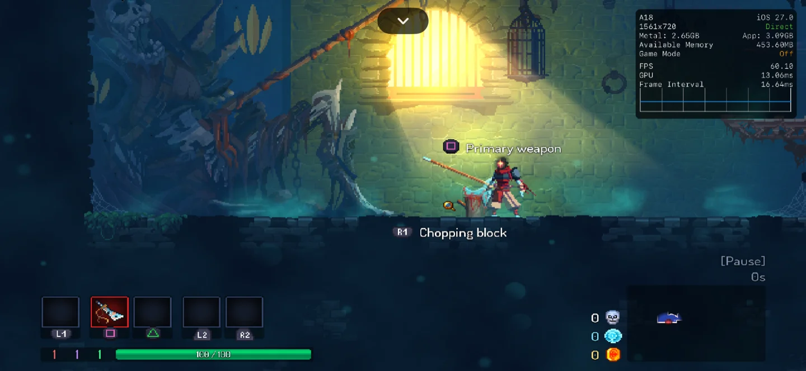
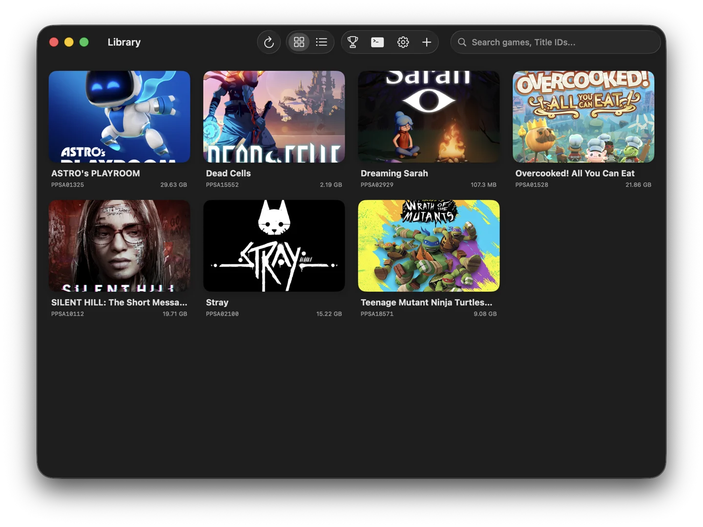
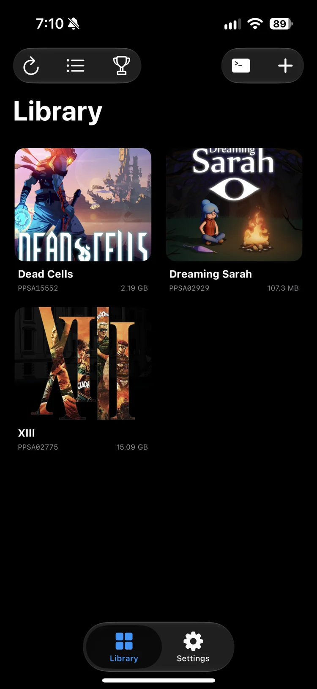

# Metaspero

Metaspero is an experimental PlayStation 5 emulator and dynamic translation layer for Apple Silicon, with support for iOS and native macOS (ARM64).

This project is forked from [KytyPS5](https://github.com/KytyPS5/KytyPS5) and updated to support ARM64 Darwin. Base documentation is in [README.upstream.md](README.upstream.md).

**Warning**: This is an early-stage experimental project. Expect crashes, visual glitches, and low frame rates.

## Screenshots

### In-Game

| Dead Cells | XIII |
| :---: | :---: |
|  |  |

### Library

| macOS | iOS |
| :---: | :---: |
|  |  |

## Requirements

### macOS

- Apple Silicon Mac (M1 or newer)
- 16 GB RAM recommended (8 GB for light 2D games)

### iOS / iPadOS

- Apple Silicon device (A-series chip, M-series chip)
- iOS 18.0 to iOS 27
- 12 GB RAM recommended (8 GB for light 2D games)
- JIT enabled
- Increased memory limit entitlement for 3D games

## x86_64 to ARM64

- Upstream macOS build: Upstream KytyPS5 builds an x86_64 binary that runs under Apple's Rosetta 2 translation layer. Apple plans to drop Rosetta 2 in a future macOS release (expected in macOS 28).
- This fork: Focuses on native ARM64 execution for iOS and macOS. It replaces Rosetta 2 with an integrated fork of FEXCore ([alamshafil/fexcore-darwin](https://github.com/alamshafil/fexcore-darwin)) to translate x86_64 to ARM64 at runtime.
- Shared codebase: The native macOS build uses the same ARM64 codebase, FEXCore JIT engine, and MoltenVK Metal renderer as the iOS build.

## iOS Memory Limit Entitlement

By default, the iOS Jetsam daemon limits standard apps to roughly 2 GB to 3 GB of RAM. Exceeding this limit causes iOS to terminate the process immediately.

Emulating the PS5 on iOS can easily exceeds default limits.

An in-app toast monitor alerts you when device memory pressure approaches the kill threshold.

## CMake Presets and Dependencies

### Presets

Configured in `CMakePresets.json`:

- `ios`: iOS device (arm64) Release build with SwiftUI app bundle
- `ios-debug`: iOS device (arm64) Debug build
- `macos-swiftui`: macOS native ARM64 SwiftUI application using FEXCore
- `macos-arm64-fex`: macOS native ARM64 CLI binary and regression tests
- `macos`: macOS x86_64 build under Rosetta 2 (upstream compatibility)

### 3rd-Party Dependencies

- FEXCore: A git submodule in `3rdparty/fexcore` pointing to `alamshafil/fexcore-darwin`. It is compiled directly in the CMake tree when `KYTY_ENABLE_FEX_GUEST_CPU=ON`.
- MoltenVK: Fetched automatically via CMake FetchContent (`cmake/MoltenVKiOS.cmake` and `cmake/MoltenVKMacOS.cmake`) from official releases.
- FFmpeg: On iOS, `cmake/FFmpegiOS.cmake` downloads FFmpeg 7.1.1 source and compiles an arm64 static library with required codecs. Desktop macOS/Linux uses `3rdparty/ffmpeg-core`.
- Other dependencies: Located in `3rdparty/` as submodules. If you get errors about build tools on macOS, check `README.upstream.md`.

## Directory Layout for iOS changes

- `3rdparty/fexcore`: FEXCore submodule fork for ARM64 Darwin JIT
- `cmake/`: CMake helper scripts for MoltenVK, FFmpeg, and platform configuration
- `docs/`: Architecture notes, JIT documentation (`docs/darwin_jit.md`), and memory architecture (`docs/darwin_memory.md`)
- `docs/screenshots/`: In-game and library screenshots
- `frontend/swift/`: SwiftUI application and Objective-C++ bridge (`KytyBridge.mm`)
- `src/loader/fex/`: FEXCore guest engine, dual-mapping allocator, HLE thunks
- `tests/`: Regression test suites
- `README.upstream.md`: Upstream KytyPS5 documentation

## Building from Source

### Prerequisites

- Apple Silicon Mac running macOS
- Xcode with iOS SDK installed
- CMake and Ninja (`brew install cmake ninja glslang python`)

### 1. Clone

Clone recursively to fetch all submodules:

```bash
git clone --recursive https://github.com/alamshafil/metaspero.git
cd metaspero

# If already cloned:
git submodule update --init --recursive
```

### 2. Build for iOS

Build with the iOS preset:

```bash
cmake --preset ios
cmake --build --preset ios -- \
  CODE_SIGNING_ALLOWED=NO CODE_SIGN_IDENTITY="" CODE_SIGNING_REQUIRED=NO
```

Package into an IPA:

```bash
mkdir -p _Build/ios/Payload
cp -R _Build/ios/frontend/swift/Release-iphoneos/Metaspero.app _Build/ios/Payload/
cd _Build/ios
zip -r -q Metaspero.ipa Payload
rm -rf Payload
```

### 3. Build for macOS (Native ARM64 + FEXCore)

Build the macOS SwiftUI app:

```bash
cmake --preset macos-swiftui
cmake --build --preset macos-swiftui
```

Build the CLI binary and run tests:

```bash
cmake --preset macos-arm64-fex
cmake --build --preset macos-arm64-fex
ctest --test-dir _Build/macos-arm64 --output-on-failure
```

### 4. Open and Build in Xcode

Generate and open projects directly in Xcode:

For iOS:

```bash
cmake --preset ios
open _Build/ios/Kyty.xcodeproj
```

Select the Metaspero scheme, choose your connected iOS device, and press Cmd+R to build and run.

For macOS:

```bash
cmake --preset macos-swiftui
open _Build/mac/Metaspero.xcodeproj
```

Select the Metaspero scheme, choose My Mac, and press Cmd+R to build and run.

## Running with JIT on iOS

iOS requires an attached debugger for JIT permissions:

1. Connect LocalDevVPN on your device.
2. Open StikDebug, select Metaspero, and run the `universal.js` script.
3. Return to Metaspero. Once JIT status shows Active, launch a game.

## Website and Compatibility Reports

Website repository: https://github.com/alamshafil/metaspero-site

### Submitting Reports

1. Web tool: Visit `/report` on the website, fill out the form, and paste the markdown into a GitHub issue.
2. Pull request: Add a file under `src/content/compatibility/<game-slug>.md` using the format described.

Status ratings:
- Playable: Runs without critical issues.
- In game: Boots into 3D gameplay with performance issues or glitches.
- Main menu: Reaches title or menu, but cannot enter gameplay.
- Logo: Displays intro logos then stops.
- Doesn't boot: Crashes on launch.

## Credits and Acknowledgments

- KytyPS5: Upstream PlayStation 5 translation layer (https://github.com/KytyPS5/KytyPS5).
- Kyty: Original emulator by InoriRus (https://github.com/InoriRus/Kyty).
- AetherPS4: The fexcore-darwin JIT fork is based on the porting work from AetherPS4 (https://github.com/Leviidev/AetherPS4).
- FEX-Emu: Fast x86_64 to ARM64 dynamic binary translation engine (https://github.com/FEX-Emu/FEX).
- MoltenVK: Vulkan implementation on Apple Metal (https://github.com/KhronosGroup/MoltenVK).

## Disclaimer and Licenses

Metaspero is an independent open-source research project and is not affiliated with or endorsed by Sony Interactive Entertainment Inc. PlayStation and related marks are trademarks of their respective owners. No copyrighted BIOS, firmware, or game assets are included.

Metaspero is licensed under the GNU General Public License version 2 (GPL-2.0-only). Upstream Kyty copyright notices are in `LICENSES/Kyty-MIT.txt`.
